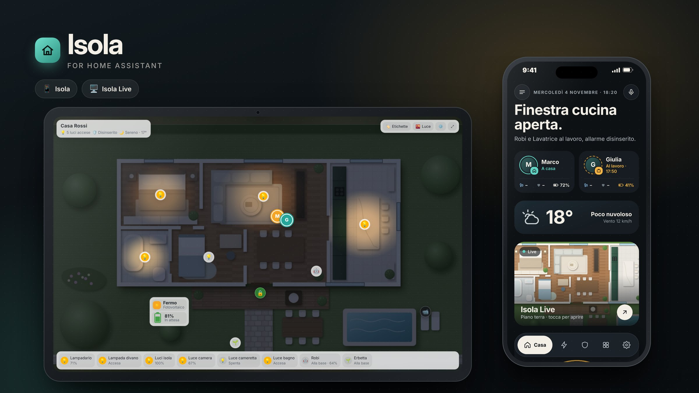
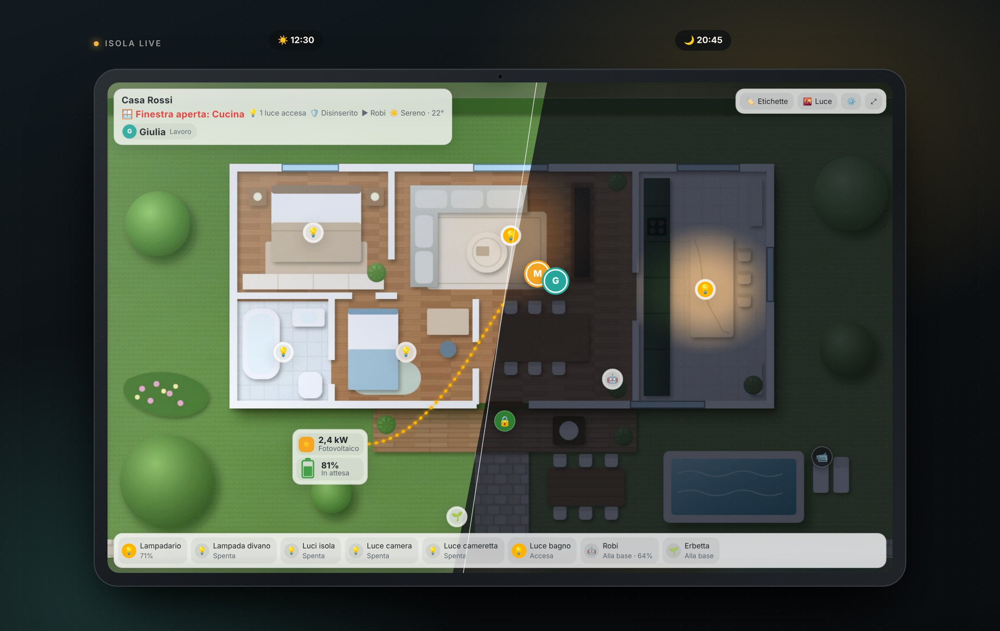
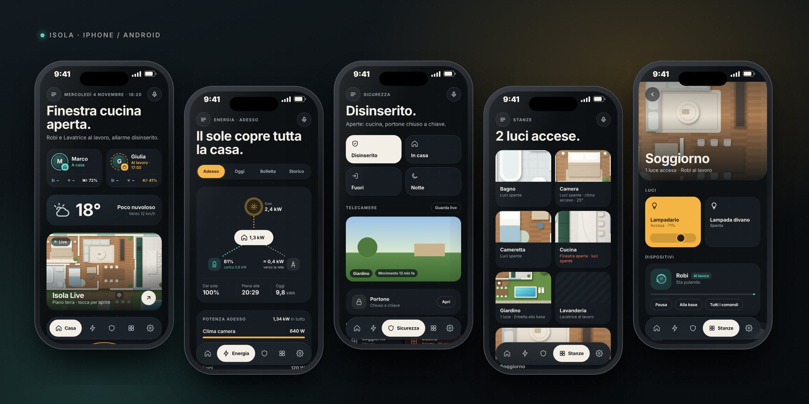

<p align="center"><a href="README.md">Italiano</a> · <b>English</b></p>

<p align="center"></p>

<h1 align="center">Isola for Home Assistant</h1>

<p align="center">
The home interface that sets itself up: elegant on your phone, alive on your tablet.<br>


</p>

> **Language note:** the interface is currently in **Italian**. English labels are on the roadmap.

---

## Two faces, one home

| | Where | Card |
|---|---|---|
| 📱 **Isola** | Smartphone (iPhone and Android, inside the Home Assistant app) | `custom:isola-mobile` |
| 🖥️ **Isola Live** | Wall tablet, fixed hub, living-room screen | `custom:isola-live` |

**Isola** is your home in your pocket. As soon as it is installed it reads your Home Assistant **areas** and **devices** and builds rooms, people, weather, energy, security, robots and scenes on its own. It tells you in one sentence what is going on at home ("Kitchen window open.", "The sun covers the whole house.") and robots only show up while they are working.

**Isola Live** is your home seen from above. A photo (or render) of your house becomes a living map: lights really switch on inside the rooms and stay within the walls, the sun and the weather change the light during the day, robots move, people come and go, solar power flows into the house. At night the tablet dims itself and turns into a picture frame with a clock and alerts.

From Isola you open Isola Live with one tap: the same home, on any screen.

<p align="center"></p>

<p align="center"></p>

### What it does

- **Home:** one sentence summing up the house, people with status and phone battery, weather, shortcut to Isola Live, alerts and tips.
- **Energy:** real-time flow sun → house → battery → grid, device consumption, today's production, bill and history.
- **Security:** alarm in one tap, cameras, open doors and windows, locks.
- **Rooms:** every Home Assistant area becomes a room with its own crop of the photo, lights (with brightness slider), climate, TV and devices.
- **Robots and appliances:** vacuum, lawn mower and washing machine appear while working, with progress and controls.
- **Isola Live:** realistic per-room lighting, day/night cycle from the real sun, moving robots, presence, solar panel, night picture-frame mode, full screen for tablets.

> **Beta release.** It works with any home's data, but it's young: if something isn't detected or doesn't look right, please open an Issue with a screenshot.

---

## Requirements

- Home Assistant **2024 or newer** (latest version recommended).
- Your rooms created as **Areas** (Settings › Areas, labels & zones) and your devices assigned to them: this is how Isola knows what is where.
- To install with HACS: [HACS](https://hacs.xyz) already installed.
- For Isola Live: a **top-down photo or render of your home** (JPG or PNG, landscape; a render from Planner 5D, Sweet Home 3D or a generated image works great).

---

## Step-by-step installation

### Step 1 · Install Isola with HACS (recommended)

1. In Home Assistant open **HACS** from the sidebar.
2. Top right, tap the **⋮** menu › **Custom repositories**.
3. In the **Repository** field paste:
   ```
   https://github.com/inusoa/isola-ha
   ```
4. As **Type** choose **Dashboard** and tap **Add**. Close the dialog.
5. Search HACS for **Isola**, open it and tap **Download** (bottom right), then confirm.
6. When HACS asks, **reload** the page. On the phone app: Settings › Companion app › Troubleshooting › **Reset frontend cache**.

HACS adds the resource `/hacsfiles/isola-ha/isola-ha.js` automatically; it loads both Isola and Isola Live.

<details>
<summary><b>Alternative: manual installation (without HACS)</b></summary>

1. Download this repository (green **Code** button › **Download ZIP**) and unzip it.
2. Copy the four files in the `dist` folder (`isola-ha.js`, `isola-mobile.js`, `isola-live.js`, `isola-live-render.js`) to `/config/www/isola-ha/` in Home Assistant, e.g. with the **File editor**, **Studio Code Server** or **Samba** add-on.
   If the `www` folder didn't exist, **restart Home Assistant** once.
3. Turn on **Advanced mode**: tap your name bottom left (Profile) and enable *Advanced mode*.
4. Go to **Settings › Dashboards**, top-right **⋮** menu › **Resources** › **Add resource**:
   - URL: `/local/isola-ha/isola-ha.js?v=1`
   - Type: **JavaScript module**
5. Reload the page (on the phone: reset the frontend cache as in step 6 above).

When you update the files by hand, change `?v=1` to `?v=2`, `?v=3`… so browsers fetch the new version.
</details>

### Step 2 · Check that it is loaded

Settings › Dashboards › **⋮** › **Resources**: there must be a line with `isola-ha.js` of type *JavaScript module*.
In the browser developer tools (console) you will see **ISOLA** and **ISOLA LIVE** with their version number.

### Step 3 · Create the Isola dashboard for your phone

1. **Settings › Dashboards › + Add dashboard › New dashboard from scratch**.
2. Title: **Isola**, any icon (e.g. `mdi:island`), keep *Show in sidebar* on. Tap **Create**.
3. Open the new dashboard, tap the **pencil** (Edit) top right, then **⋮** › **Raw configuration editor**.
4. Delete everything and paste:
   ```yaml
   views:
     - title: Isola
       path: isola
       type: panel
       cards:
         - type: custom:isola-mobile
   ```
5. Tap **Save** and close the editor.

Done: Isola finds rooms, people and devices on its own.
The **panel** view type makes Isola fill the whole phone screen.

**To always open it when the app starts:** on the phone tap your name (Profile) › **Dashboard** (in the browser/device settings) and choose **Isola**.

### Step 4 · Add the photo of your home (recommended)

1. Create the folder `/config/www/isola/` and copy the top-down photo of your home into it, e.g. `casa.jpg`.
   (If the `www` folder is new, restart Home Assistant once.)
2. The photo will be available at `/local/isola/casa.jpg`.
3. Go back to Isola's raw configuration and add the photo to the card:
   ```yaml
       cards:
         - type: custom:isola-mobile
           image: /local/isola/casa.jpg
   ```

To give each room **its own piece of the photo**, set the room's rectangle in photo pixels (`[left x, top y, right x, bottom y]`; the name is the Home Assistant area name):

```yaml
room_crops:
  Living room: [510, 120, 900, 510]
  Kitchen:     [910, 120, 1130, 510]
  Bedroom:     [240, 120, 500, 330]
```

> **How do I find the pixels?** Open the photo in any image editor (Preview on Mac, Paint on Windows, Photopea online): moving the mouse shows the x, y coordinates. The top-left corner is 0, 0.

### Step 5 · Isola Live on the tablet

1. Create a second dashboard as in step 3, titled **Isola Live** (or **Home**).
2. In the raw configuration paste:
   ```yaml
   views:
     - title: Home
       path: home
       type: panel
       cards:
         - type: custom:isola-live
           image: /local/isola/casa.jpg
           kiosk: true        # full screen on the tablet
           night_dim: true    # dims itself at night
           quadro: true       # after a few minutes: clock, weather and alerts
   ```
3. Save. You'll see your home with the bottom bar already listing the lights, robots and people found automatically.

**Now put things in their place on the photo.** Every item is placed with `px: [x, y]` (photo pixels). Lights and robots are matched by `id`, which is the entity name without its domain (`light.living_room_ceiling` → `living_room_ceiling`):

```yaml
         - type: custom:isola-live
           image: /local/isola/casa.jpg
           kiosk: true
           ppm: 34              # photo pixels per metre (light size, robot speed)
           lights:
             - id: living_room_ceiling
               px: [700, 230]                      # where the lamp is
               room: [[510,124],[900,124],[900,506],[650,506],[650,336],[510,336]]   # room outline: light stays inside the walls
             - id: bedroom
               px: [370, 225]
               room: [[244,124],[496,124],[496,326],[244,326]]
           devices:
             - id: robi                            # vacuum.robi
               px: [870, 470]                      # charging dock
               area_px: [[530, 360, 880, 490]]     # where it moves while cleaning
           sensors:
             - { id: kitchen_window, type: window, entity: binary_sensor.kitchen_window, name: Kitchen, px: [1030, 118] }
             - { id: front_door, type: lock, entity: lock.front_door, name: Door, px: [690, 540] }
             - { id: garden_cam, type: camera, entity: camera.garden, name: Garden, px: [1220, 600] }
           energy: { px: [470, 600], house_px: [700, 330] }   # solar/battery box and house point
           presence:
             binary_sensor.living_room_motion: [760, 300]     # where people appear for that room
```

**How do I work out `ppm`?** Measure in pixels a wall whose length you know: if a 10 m wall is 340 pixels long, `ppm` is 34.

**The same map on your phone:** in Isola (step 3) add `casa_live:` with the same configuration as Isola Live (without `type`). Tapping the *Isola Live* tile on the Home page opens the map full screen.

### Step 6 · Set up the tablet

- **Home Assistant app** (Android, iPad) or **Fully Kiosk Browser** (Android, recommended for wall tablets).
- Open the **Isola Live** dashboard and set it as the default for that device (Profile › Dashboard).
- With `kiosk: true` Isola Live hides Home Assistant's bars. To edit the dashboard, open its address with `?nokiosk` at the end, or use the ⚙️ button in the top bar to get back to the app settings.
- Keep the screen always on (Fully Kiosk: *Screen On*; companion app: app settings).

### Step 7 · Updates

With HACS: new versions appear in **Settings › Updates**. Install and reload the page (on the phone: reset the frontend cache).

---

## Configuration

Anything you write in the card overrides what Isola detects. To turn off automatic configuration: `auto: false`.

### Isola (`custom:isola-mobile`)

| Key | Example | What it does |
|---|---|---|
| `image` | `/local/isola/casa.jpg` | Home photo (cover and room crops) |
| `room_crops` | `{ Kitchen: [910,120,1130,510] }` | Piece of the photo for each room |
| `weather` | `weather.home` | Weather (if you have more than one) |
| `alarm` | `alarm_control_panel.home` | Alarm panel |
| `pv_power` / `pv_today` | `sensor.inverter_power` | Solar: current power and today's yield |
| `battery_soc` / `battery_power` | `sensor.battery_level` | Home battery: level (%) and power |
| `battery_invert` | `true` | If your battery reports charging as negative |
| `scenes` | see below | Scene buttons (Leaving, Night, …) |
| `waste` | `{ today: sensor.waste_today, tomorrow: sensor.waste_tomorrow, from: 17, to: 20 }` | Waste-collection reminder |
| `casa_live` | same as Isola Live | Map opened from the phone |
| `auto` | `false` | Turns off automatic configuration |

Scene example:

```yaml
scenes:
  out:   { name: Leaving, action: script.turn_on, target: script.leaving_home }
  night: { name: Night,   action: script.turn_on, target: script.good_night }
```

Isola detects scripts named like *leave/away*, *night/good night*, *morning*, *home/welcome* on its own (Italian names too).

### Isola Live (`custom:isola-live`)

| Key | Example | What it does |
|---|---|---|
| `image` | `/local/isola/casa.jpg` | The top-down photo of your home |
| `ppm` | `34` | Photo pixels per metre |
| `kiosk` | `true` | Full screen on the tablet |
| `night_dim` | `true` | Dims the screen at night |
| `quadro` / `quadro_after` | `true` / `3` | Picture-frame mode after N minutes without touches |
| `image_north` | `20` | Degrees between north and the top of the photo (more realistic sunlight) |
| `lights` | `{ id, px, room, radius }` | Lights on the photo and room outline |
| `devices` | `{ id, px, area_px }` | Robots: dock and working area |
| `sensors` | `{ id, type, entity, name, px }` | Windows, doors, locks, cameras, motion |
| `energy` | `{ px, house_px }` | Solar and battery box |
| `presence` | `{ binary_sensor.x: [x, y] }` | Where people appear based on motion |
| `title` | `The Smiths` | Title top left |

---

## Troubleshooting

| What you see | What to do |
|---|---|
| *Custom element doesn't exist: isola-mobile* or *Configuration error* | The resource isn't loaded: check step 2, then reload. On the phone, reset the frontend cache. |
| After an update I still see the old version | Reset the frontend cache in the app, or hard-reload (Ctrl+Shift+R on a computer). With a manual install, bump `?v=` in the resource. |
| The photo doesn't show | Check the file is in `/config/www/isola/` and the address is `/local/isola/…`. If the `www` folder is new, restart Home Assistant. |
| A room or device is missing | Assign the device to an **Area** in Home Assistant. Hidden and diagnostic entities are ignored on purpose. |
| The tablet stays full screen and I can't edit | Open the dashboard with `?nokiosk` at the end of the address. |
| The light "leaks" out of the room | Add `room:` to the light with the room outline in pixels. |

---

## Try it without installing

The [`demo`](demo) folder contains the *Rossi family* demo home with simulated data: `demo.html` for Isola and `demo-live.html` for Isola Live. Serve it with a small local server, e.g. from the repository folder:

```bash
python3 -m http.server 8000
# then open http://localhost:8000/demo/demo.html
```

All images on this page were made with the demo home.

---

© Isola – all rights reserved. Use permitted only under licence.
