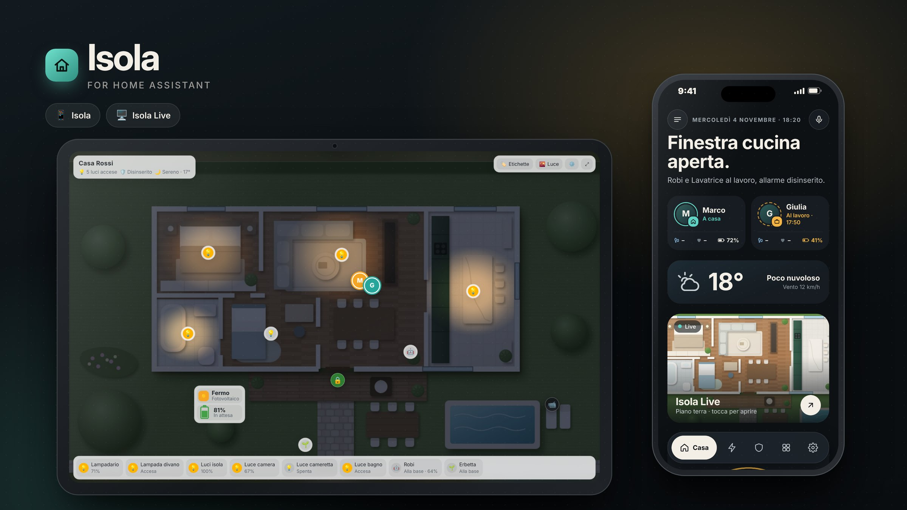
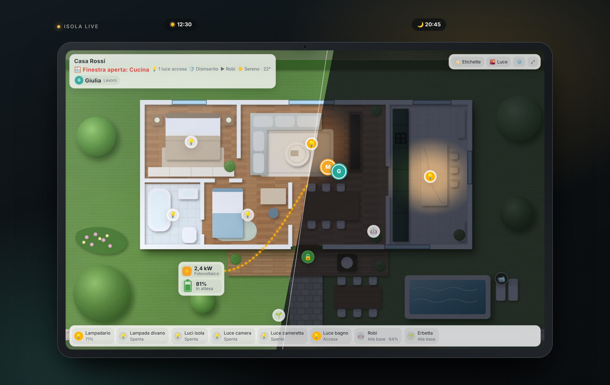
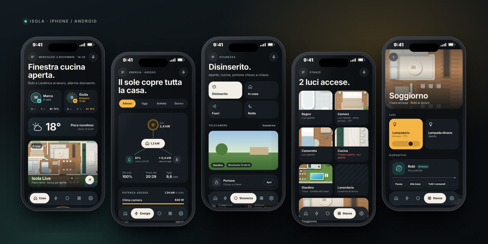
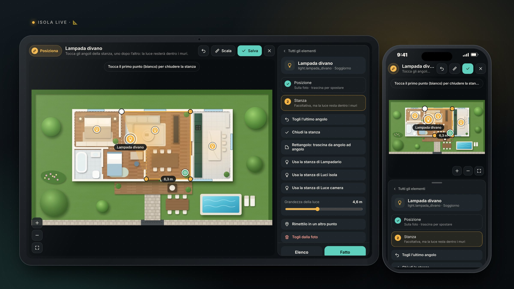

<p align="center"><b>Italiano</b> · <a href="README.en.md">English</a></p>

<p align="center"></p>

<h1 align="center">Isola per Home Assistant</h1>

<p align="center">
L'interfaccia di casa che si configura da sola: elegante sul telefono, viva sul tablet.<br>
<a href="https://github.com/inusoa/isola-ha/releases/latest"></a>
<a href="https://github.com/inusoa/isola-ha/releases"></a>
<a href="https://github.com/inusoa/isola-ha/stargazers"></a>
<a href="https://my.home-assistant.io/redirect/hacs_repository/?owner=inusoa&repository=isola-ha&category=plugin"></a>
<a href="LICENSE"></a>
</p>

<p align="center">
<a href="https://inusoa.github.io/isola-ha/"></a>
<a href="https://buymeacoffee.com/inusoa"></a>
</p>

---

> 🌍 **Italiano e inglese.** Isola parla la lingua di Home Assistant: in italiano se Home Assistant è in italiano, in inglese per tutte le altre lingue. Si può forzare con `language: it` o `language: en`.

## Due volti, una casa

| | Dove si usa | Card |
|---|---|---|
| 📱 **Isola** | Smartphone (iPhone e Android, nell'app di Home Assistant) | `custom:isola-mobile` |
| 🖥️ **Isola Live** | Tablet a parete, hub fisso, schermo in salotto | `custom:isola-live` |

**Isola** è la casa in tasca. Appena installata legge le **aree** e i **dispositivi** di Home Assistant e costruisce da sola stanze, persone, meteo, energia, sicurezza, robot e scene. Ti dice in una frase cosa succede in casa ("Finestra cucina aperta.", "Il sole copre tutta la casa.") e i robot compaiono solo quando lavorano.

**Isola Live** è la casa vista dall'alto. La foto (o il render) della tua casa diventa una mappa viva: le luci si accendono davvero nelle stanze e restano dentro i muri, il sole e il meteo cambiano la luce durante il giorno, i robot si muovono, le persone entrano ed escono, il fotovoltaico scorre verso la casa. Di notte il tablet si abbassa da solo e diventa un quadro con orologio e avvisi.

Da Isola si apre Isola Live con un tocco: la stessa casa, su qualsiasi schermo.

<p align="center"></p>

<p align="center"></p>

### Cosa fa

- **Casa:** una frase che riassume la casa, persone con stato e batteria del telefono, meteo, scorciatoia a Isola Live, avvisi e consigli.
- **Energia:** flusso sole → casa → batteria → rete in tempo reale, consumi dei dispositivi, produzione di oggi, bolletta e storico.
- **Sicurezza:** allarme in un tocco, telecamere, porte e finestre aperte, serrature.
- **Stanze:** ogni area di Home Assistant diventa una stanza con il suo ritaglio della foto, luci (con regolazione dell'intensità), clima, TV e dispositivi.
- **Robot ed elettrodomestici:** aspirapolvere, tagliaerba e lavatrice compaiono quando lavorano, con avanzamento e comandi.
- **Isola Live:** luci realistiche per stanza, ciclo giorno/notte dal sole vero, robot in movimento, presenze, fotovoltaico, modalità quadro notturna, schermo intero per tablet.
- **Configuratore visivo:** luci, stanze, robot e sensori si mettono sulla foto con un dito e si salvano nella dashboard, senza scrivere YAML.
- **Luci a colori:** sotto la luminosità, il cursore del colore e quello del bianco (caldo → freddo) quando la lampadina li supporta.
- **Campanello:** quando suonano, Isola Live apre la telecamera dal vivo con **Parla** (l'audio a due vie della finestra della telecamera) e **Chiudi**.
- **Energia senza configurare:** se hai indicato i sensori di potenza nel cruscotto Energia di Home Assistant, Isola usa quelli.
- **Pronta in un tocco:** la dashboard **Isola** compare tra quelle da creare, Isola Live tra le sezioni della community, e le card hanno l'editor visivo.

> **Versione beta.** Funziona con i dati di qualsiasi casa, ma è giovane: se qualcosa non viene trovato o non si vede bene, apri una segnalazione (Issue) con uno screenshot.

---

## Requisiti

- Home Assistant **2024 o più recente** (consigliata l'ultima versione).
- Le stanze di casa create come **Aree** (Impostazioni › Aree, etichette e zone) e i dispositivi assegnati alle aree: è da qui che Isola capisce cosa sta dove.
- Per installare: il **Marketplace** di Home Assistant (2026.11 o più recente) oppure [HACS](https://hacs.xyz) sulle versioni precedenti.
- Per Isola Live: niente, la casa 3D si disegna da sola dalle aree. Per un risultato fotografico, una **foto o un render della casa vista dall'alto** (JPG o PNG, orizzontale; va benissimo un render di Planner 5D, Sweet Home 3D o un'immagine generata).

---

## Installazione passo passo

### Passo 1 · Installa Isola

**Il modo più veloce:** apri questa pagina dal computer o dal telefono su cui usi Home Assistant e tocca il pulsante.

[](https://my.home-assistant.io/redirect/hacs_repository/?owner=inusoa&repository=isola-ha&category=plugin)

Si apre Home Assistant sulla scheda di Isola: tocca **Scarica** (*Download*), conferma e **ricarica** la pagina. Se usi l'app sul telefono: Impostazioni › App complementare › Risoluzione dei problemi › **Ripristina la cache del frontend**.

<details open>
<summary><b>Home Assistant 2026.11 o più recente: dal Marketplace</b></summary>

Dalla 2026.11 le card della community si installano dal **Marketplace** di Home Assistant (ha preso il posto di HACS).

1. Apri **Impostazioni › Marketplace**.
2. Cerca **Isola** (è nel catalogo ufficiale della community).
3. Aprila, tocca **Scarica** e ricarica la pagina.
</details>

<details>
<summary><b>Home Assistant più vecchio: con HACS</b></summary>

1. In Home Assistant apri **HACS** dalla barra laterale.
2. Cerca **Isola** (è nel catalogo predefinito di HACS).
3. Aprila e tocca **Scarica** (*Download*), poi conferma e ricarica la pagina.

Se non la trovi subito, in HACS tocca **⋮ › Aggiorna informazioni** (il catalogo si aggiorna ogni qualche ora).
</details>

In tutti e due i casi la risorsa `/hacsfiles/isola-ha/isola-ha.js` si aggiunge da sola e carica sia Isola sia Isola Live.

<details>
<summary><b>In alternativa: installazione a mano</b></summary>

1. Apri l'[ultima release](https://github.com/inusoa/isola-ha/releases/latest) e, in fondo, sotto **Assets**, scarica **`isola-ha.js`** e **`three.module.min.js`** (Isola è un file solo; `three.module.min.js` serve alla casa 3D e va messo nella stessa cartella).
2. Copiali in `/config/www/isola-ha/` di Home Assistant, per esempio con l'add-on **File editor**, **Studio Code Server** o **Samba**.
   Se la cartella `www` non esisteva, **riavvia Home Assistant** una volta.
3. Attiva la **Modalità avanzata**: tocca il tuo nome in basso a sinistra (Profilo) e accendi *Modalità avanzata*.
4. Vai in **Impostazioni › Dashboard**, menu **⋮** in alto a destra › **Risorse** › **Aggiungi risorsa**:
   - URL: `/local/isola-ha/isola-ha.js?v=1`
   - Tipo: **Modulo JavaScript**
5. Ricarica la pagina (sul telefono: ripristina la cache del frontend).

Quando aggiorni i file a mano, cambia `?v=1` in `?v=2`, `?v=3`… così i browser scaricano la versione nuova.
</details>

### Passo 2 · Controlla che sia caricato

Impostazioni › Dashboard › **⋮** › **Risorse**: deve esserci una riga con `isola-ha.js` di tipo *Modulo JavaScript*.
Se apri gli strumenti per sviluppatori del browser (console), vedi le scritte **ISOLA** e **ISOLA LIVE** con il numero di versione.

### Passo 3 · Crea la dashboard Isola per il telefono

**Il modo più veloce (Home Assistant 2026.5 o più recente):** **Impostazioni › Dashboard › + Aggiungi dashboard** e scegli **Isola** nell'elenco. Si crea una dashboard con due viste già pronte, **Isola** per il telefono e **Isola Live** per il tablet. Per cambiarla poi, prendine il controllo dalla matita.

**Oppure, a mano:**

1. **Impostazioni › Dashboard › + Aggiungi dashboard › Nuova dashboard da zero**.
2. Nome: **Isola**, icona a piacere (per esempio `mdi:island`), lascia attivo *Mostra nella barra laterale*. Tocca **Crea**.
3. Apri la nuova dashboard, tocca la **matita** (Modifica) in alto a destra, poi **⋮** › **Editor di configurazione grezza** (*Raw configuration editor*).
4. Cancella tutto e incolla:
   ```yaml
   views:
     - title: Isola
       path: isola
       type: panel
       cards:
         - type: custom:isola-mobile
   ```
5. Tocca **Salva** e chiudi l'editor.

Fatto: Isola trova da sola stanze, persone e dispositivi.
Il tipo di vista **panel** fa sì che Isola occupi tutto lo schermo del telefono.

**Per aprirla sempre all'avvio dell'app:** sul telefono tocca il tuo nome (Profilo) › **Dashboard** (nelle impostazioni del browser/dispositivo) e scegli **Isola**.

### Passo 4 · Aggiungi la foto della casa (consigliato)

1. Crea la cartella `/config/www/isola/` e copiaci la foto della casa vista dall'alto, per esempio `casa.jpg`.
   (Se la cartella `www` è nuova, riavvia Home Assistant una volta.)
2. La foto sarà raggiungibile all'indirizzo `/local/isola/casa.jpg`.
3. Torna nella configurazione grezza di Isola e aggiungi la foto alla card:
   ```yaml
       cards:
         - type: custom:isola-mobile
           image: /local/isola/casa.jpg
   ```

Per far vedere a ogni stanza il **suo pezzo di foto**, indica il rettangolo della stanza in pixel della foto (`[x sinistra, y alto, x destra, y basso]`; il nome è quello dell'area in Home Assistant):

```yaml
room_crops:
  Soggiorno: [510, 120, 900, 510]
  Cucina:    [910, 120, 1130, 510]
  Camera:    [240, 120, 500, 330]
```

> **Come trovo i pixel?** Apri la foto in un qualsiasi programma di grafica (Anteprima su Mac, Paint su Windows, Photopea online): spostando il mouse vedi le coordinate x, y. L'angolo in alto a sinistra è 0, 0.

### Senza foto: la casa 3D automatica 🏠

Non hai una foto o un render della casa? **Non serve.** Se nella card manca `image`, Isola Live costruisce da sola una casa 3D con le tue stanze:

- una stanza per ogni **area** di Home Assistant, con pavimento e arredi presi dal nome (camera, cameretta, soggiorno, cucina, bagno, studio, lavanderia, garage…);
- un modello per ogni **piano** di Home Assistant (fino a due, con i pulsanti per passare da uno all'altro);
- il **garage** fuori dal blocco principale, il **giardino** intorno se hai un'area esterna;
- luci, finestre, serratura, robot, movimento e fotovoltaico **già al loro posto**.

La disposizione è casuale ma sempre la stessa per la tua casa. Nel configuratore (📐 Posiziona) trovi **Rigenera**, per un'altra disposizione, e **Scambia**: tocchi due stanze e si scambiano di posto. Il risultato si salva nella card (`house:`).

La casa viene disegnata sul dispositivo la prima volta (pochi secondi, di più su un tablet economico) e poi resta in memoria. Non è la pianta vera: per quella aggiungi la tua foto con `image:`.

Prova: [demo senza foto](https://inusoa.github.io/isola-ha/demo/demo-auto.html?lang=it).

### Passo 5 · Isola Live sul tablet

1. Crea una seconda dashboard come al passo 3, con nome **Isola Live** (o **Casa**).
2. Nella configurazione grezza incolla:
   ```yaml
   views:
     - title: Casa
       path: casa
       type: panel
       cards:
         - type: custom:isola-live
           image: /local/isola/casa.jpg
           kiosk: true        # schermo intero sul tablet
           night_dim: true    # di notte si abbassa da solo
           quadro: true       # dopo qualche minuto: orologio, meteo e avvisi
   ```
3. Salva. Vedrai la casa con la barra in basso che contiene già luci, robot e persone trovate da sole.

**In una dashboard a sezioni (Home Assistant 2026.11):** in modifica tocca **+ Aggiungi sezione** e scegli **Isola Live** tra le *sezioni della community*: occupa tutta la larghezza. Puoi anche aggiungere la card dal selettore delle card: foto, titolo, lingua, schermo intero e casa 3D si impostano dall'editor visivo, senza YAML.

### Passo 5b · Metti le cose al loro posto: il configuratore 📐

Non serve scrivere coordinate. Se sei **amministratore** di Home Assistant, nella barra in alto di Isola Live trovi il pulsante **📐 Posiziona**.

<p align="center"></p>

1. Tocca **Posiziona**: si apre il configuratore a schermo intero, con l'elenco di tutto quello che Isola ha trovato (luci, robot, porte e finestre, serrature, telecamere, movimento, fotovoltaico).
2. Scegli un elemento e **tocca la foto** nel punto in cui si trova. I segnaposto si **trascinano** per aggiustarli.
3. Per le **luci** tocca gli angoli della stanza, uno dopo l'altro, e chiudi toccando il primo punto: vedi subito la luce che resta dentro i muri. In alternativa puoi trascinare un **rettangolo**, oppure **usare la stanza di un'altra luce**. Gli angoli si agganciano a quelli delle stanze già disegnate, così le pareti in comune combaciano. Con il cursore scegli quanto è grande la luce.
4. Per i **robot** tocca la base di ricarica, poi trascina uno o più rettangoli dove lavorano. Per il **fotovoltaico** tocca il riquadro e poi il punto della casa.
5. **Scala:** tocca le due estremità di un muro di cui conosci la lunghezza e scrivi i metri. La scala si calcola da sola.
6. Tocca **Salva** › **Salva nella dashboard**.

Cosa succede quando salvi:
- Viene aggiornata **solo la configurazione di questa card**: il resto della dashboard non si tocca.
- **Prima** di salvare viene tenuta una copia della configurazione precedente. Con **Annulla il salvataggio** (o, più tardi, **Ripristina quella versione** nella finestra Salva) torni indietro con un tocco.
- Funziona su **tablet, computer e telefono**: si sposta la foto con un dito, si ingrandisce con due dita o con i pulsanti **+ / −**. **↶** annulla l'ultima modifica.
- Se apri Isola Live dal telefono (la scheda *Isola Live* di Isola), il configuratore salva dentro la card di Isola, nella chiave `casa_live`.
- Se la dashboard è scritta in **YAML** o è generata automaticamente da Home Assistant, non si può salvare da qui: tocca **Copia YAML** e incolla il testo nella card.

<details>
<summary><b>Configurazione a mano (per chi preferisce lo YAML)</b></summary>

Ogni elemento si posiziona con `px: [x, y]` (pixel della foto). Le luci e i robot si riconoscono dall'`id`, che è il nome dell'entità senza il dominio (`light.lampadario_soggiorno` → `lampadario_soggiorno`):

```yaml
         - type: custom:isola-live
           image: /local/isola/casa.jpg
           kiosk: true
           ppm: 34              # pixel per metro della foto (grandezza delle luci, velocità dei robot)
           lights:
             - id: lampadario_soggiorno
               px: [700, 230]                      # dove sta la lampada
               room: [[510,124],[900,124],[900,506],[650,506],[650,336],[510,336]]   # contorno della stanza: la luce resta dentro i muri
             - id: luce_camera
               px: [370, 225]
               room: [[244,124],[496,124],[496,326],[244,326]]
           devices:
             - id: robi                            # vacuum.robi
               px: [870, 470]                      # base di ricarica
               area_px: [[530, 360, 880, 490]]     # dove si muove mentre pulisce
           sensors:
             - { id: fin_cucina, type: window, entity: binary_sensor.finestra_cucina, name: Cucina, px: [1030, 118] }
             - { id: porta, type: lock, entity: lock.porta_ingresso, name: Porta, px: [690, 540] }
             - { id: cam_giardino, type: camera, entity: camera.giardino, name: Giardino, px: [1220, 600] }
           energy: { px: [470, 600], house_px: [700, 330] }   # riquadro fotovoltaico e punto della casa
           presence:
             binary_sensor.movimento_soggiorno: [760, 300]    # dove compare chi è in quella stanza
```

**Come calcolo `ppm`?** Misura in pixel un muro di cui conosci la lunghezza: se una parete di 10 m è lunga 340 pixel, `ppm` è 34.
</details>

**La stessa casa anche nel telefono:** in Isola (passo 3) aggiungi `casa_live:` con la stessa configurazione di Isola Live (senza `type`), oppure usa il configuratore da lì. Toccando la scheda *Isola Live* nella pagina Casa, si apre la mappa a schermo intero.

### Passo 6 · Prepara il tablet

- **App di Home Assistant** (Android, iPad) oppure **Fully Kiosk Browser** (Android, consigliato per tablet a parete).
- Apri la dashboard **Isola Live** e impostala come predefinita per quel dispositivo (Profilo › Dashboard).
- Con `kiosk: true` Isola Live nasconde le barre di Home Assistant. Per modificare la dashboard, apri l'indirizzo con `?nokiosk` alla fine, oppure usa il pulsante ⚙️ della barra in alto per tornare alle impostazioni dell'app.
- Tieni lo schermo sempre acceso (in Fully Kiosk: *Screen On*; nell'app: impostazioni dell'app complementare).

### Passo 7 · Aggiornamenti

Con il Marketplace o con HACS: quando esce una nuova versione compare in **Impostazioni › Aggiornamenti**. Installala e ricarica la pagina (sul telefono: ripristina la cache del frontend).

---

## Configurazione

Tutto quello che scrivi nella card ha la precedenza su ciò che Isola trova da sola. Per spegnere la configurazione automatica: `auto: false`.

### Isola (`custom:isola-mobile`)

| Chiave | Esempio | A cosa serve |
|---|---|---|
| `image` | `/local/isola/casa.jpg` | Foto della casa (copertina e ritagli delle stanze) |
| `room_crops` | `{ Soggiorno: [510,120,900,510] }` | Pezzo di foto per ogni stanza |
| `weather` | `weather.casa` | Meteo (se ne hai più di uno) |
| `alarm` | `alarm_control_panel.casa` | Allarme |
| `pv_power` / `pv_today` | `sensor.inverter_potenza` | Fotovoltaico: potenza attuale e produzione di oggi (se non lo scrivi, vale il sensore di potenza del cruscotto Energia) |
| `battery_soc` / `battery_power` | `sensor.batteria_livello` | Batteria di casa: livello (%) e potenza |
| `battery_invert` | `true` | Se la tua batteria segna la carica come negativa |
| `scenes` | vedi sotto | Pulsanti scena (Esco, Notte, …) |
| `waste` | `{ today: sensor.raccolta_oggi, tomorrow: sensor.raccolta_domani, from: 17, to: 20 }` | Promemoria della raccolta differenziata |
| `casa_live` | stessa configurazione di Isola Live | Mappa che si apre dal telefono |
| `auto` | `false` | Spegne la configurazione automatica |
| `language` | `auto` / `it` / `en` | Lingua: segue Home Assistant (italiano, oppure inglese per tutte le altre lingue) |

Esempio di scene:

```yaml
scenes:
  out:   { name: Esco,  action: script.turn_on, target: script.esco_di_casa }
  night: { name: Notte, action: script.turn_on, target: script.buonanotte }
```

Isola riconosce da sola gli script che si chiamano come *esco*, *notte/buonanotte*, *buongiorno*, *sono a casa*.

### Isola Live (`custom:isola-live`)

| Chiave | Esempio | A cosa serve |
|---|---|---|
| `image` | `/local/isola/casa.jpg` | La foto della casa vista dall'alto (senza: casa 3D automatica) |
| `house` | `{ seed: 123, swaps: [[cucina, camera]] }` | Casa 3D automatica: disposizione e stanze scambiate (lo scrive il configuratore). `house: false` la spegne |
| `ppm` | `34` | Pixel per metro della foto |
| `kiosk` | `true` | Schermo intero sul tablet |
| `night_dim` | `true` | Di notte lo schermo si abbassa |
| `quadro` / `quadro_after` | `true` / `3` | Modalità quadro dopo N minuti senza tocchi |
| `image_north` | `20` | Gradi tra il nord e l'alto della foto (luce del sole più realistica) |
| `lights` | `{ id, px, room, radius }` | Luci sulla foto e contorno della stanza |
| `devices` | `{ id, px, area_px }` | Robot: base e zona di lavoro |
| `sensors` | `{ id, type, entity, name, px }` | Finestre, porte, serrature, telecamere, movimento |
| `energy` | `{ px, house_px }` | Riquadro fotovoltaico e batteria |
| `presence` | `{ binary_sensor.x: [x, y] }` | Dove compaiono le persone in base al movimento |
| `title` | `Casa Rossi` | Titolo in alto a sinistra |
| `doorbell` | `event.campanello` oppure `{ entity: binary_sensor.ding, camera: camera.ingresso }` | Campanello e telecamera da aprire quando suonano (di solito li trova da solo). `doorbell: false` lo spegne |
| `language` | `auto` / `it` / `en` | Lingua dell'interfaccia e del configuratore |

---

## Problemi comuni

| Cosa vedi | Cosa fare |
|---|---|
| *Custom element doesn't exist: isola-mobile* o *Errore di configurazione* | La risorsa non è caricata: controlla il passo 2, poi ricarica la pagina. Sul telefono ripristina la cache del frontend. |
| Dopo un aggiornamento vedo ancora la versione vecchia | Ripristina la cache del frontend nell'app, o ricarica forzando (Ctrl+Shift+R sul computer). Con l'installazione a mano cambia `?v=` nella risorsa. |
| La foto non si vede | Controlla che il file sia in `/config/www/isola/` e l'indirizzo in `/local/isola/…`. Se la cartella `www` è nuova, riavvia Home Assistant. |
| Una stanza o un dispositivo manca | Assegna il dispositivo a un'**Area** in Home Assistant. Le entità nascoste o di diagnostica vengono ignorate di proposito. |
| Il tablet resta a schermo intero e non riesco a modificare | Apri la dashboard con `?nokiosk` alla fine dell'indirizzo. |
| La luce "esce" dalla stanza | Nel configuratore apri la luce › **Stanza** e disegna il contorno (oppure aggiungi `room:` a mano). |
| Non vedo il pulsante 📐 Posiziona | Compare solo agli **amministratori** di Home Assistant e solo se la card ha la foto (`image`). |
| "Questa dashboard non si può modificare da qui" | La dashboard è in YAML o generata automaticamente: tocca **Copia YAML** e incollalo nella card, oppure prendi il controllo della dashboard. |

---

## Prova senza installare

👉 **[Apri la demo online](https://inusoa.github.io/isola-ha/?lang=it)**: Isola e Isola Live con la casa dimostrativa, direttamente nel browser.

Oppure in locale:

La cartella [`demo`](demo) contiene la casa dimostrativa *Famiglia Rossi* con dati simulati: `demo.html` per Isola e `demo-live.html` per Isola Live. Si apre con un piccolo server locale, per esempio dalla cartella del repository:

```bash
python3 -m http.server 8000
# poi apri http://localhost:8000/demo/demo.html
```

Tutte le immagini di questa pagina sono state fatte con la casa dimostrativa.

---

## Per sviluppatori: come si costruisce

Il codice è in `src/`. Il file che installano Marketplace e HACS, `dist/isola-ha.js`, si costruisce da `src/` con [esbuild](https://esbuild.github.io):

```
npm install
npm run build     # ricostruisce dist/isola-ha.js e dist/three.module.min.js
npm run check     # controlla che dist/ corrisponda a src/ (lo fa anche GitHub a ogni commit)
```

Isola non carica nulla da siti esterni: niente CDN, niente font da Google. three.js (r163, MIT) viene dal file `three.module.min.js` accanto a `isola-ha.js`.

## Sostieni Isola

Isola è gratuita e open source, e lo resterà. Se ti rende la casa più bella da vivere, un caffè mi aiuta a migliorarla: nuove funzioni, altre lingue, più dispositivi supportati.

<a href="https://buymeacoffee.com/inusoa"></a>

Idee, problemi o richieste: apri una [segnalazione](https://github.com/inusoa/isola-ha/issues).

---

Distribuita con licenza [MIT](LICENSE). Include [three.js](https://threejs.org) (MIT) per la casa 3D automatica.
