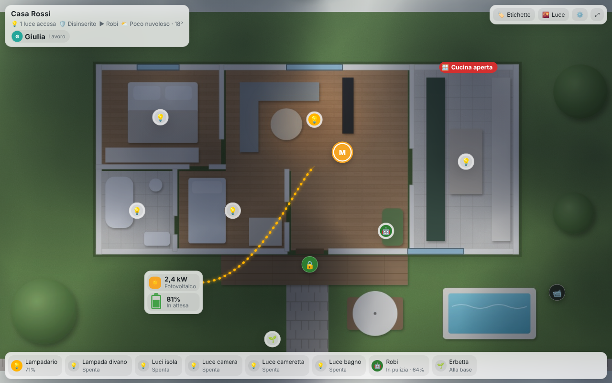
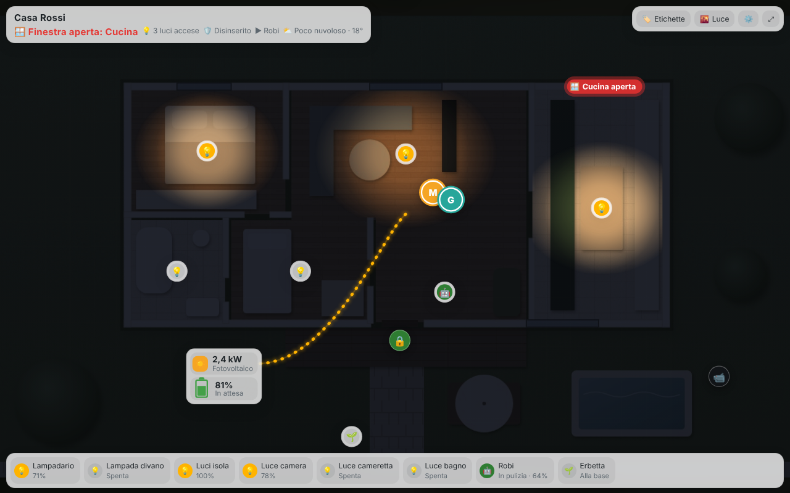

# Isola per Home Assistant

**Isola** è l'interfaccia di casa per Home Assistant: elegante, viva e che si configura da sola.
Ha due volti, pensati per due modi diversi di vivere la casa:

| | Dove si usa | Card |
|---|---|---|
| **Isola** | Smartphone (iPhone e Android) | `custom:isola-mobile` |
| **Isola Live** | Tablet a parete, hub fisso, schermo in salotto | `custom:isola-live` |

- **Isola** è la casa in tasca: persone, meteo, energia, sicurezza, stanze e dispositivi, con i robot che compaiono solo quando lavorano.
- **Isola Live** è la casa vista dall'alto: la foto (render) della tua casa diventa una mappa interattiva. Le luci si accendono davvero nelle stanze, il sole e il meteo cambiano la luce durante il giorno, i robot si muovono, le persone entrano ed escono, e di notte il tablet diventa un quadro con orologio e avvisi.

Da Isola si apre Isola Live con un tocco: la stessa casa, su qualsiasi schermo.




---

## Installazione

### Con HACS (consigliata)
1. HACS › menu ⋮ › **Repository personalizzati**
2. Repository: `https://github.com/inusoa/isola-ha` · Tipo: **Dashboard**
3. Cerca **Isola** e installa
4. Ricarica la pagina (o svuota la cache del frontend nell'app)

### A mano
1. Copia la cartella `dist` in `/config/www/isola-ha/`
2. Impostazioni › Dashboard › ⋮ › **Risorse** › Aggiungi: `/local/isola-ha/isola-ha.js` · tipo **Modulo JavaScript**

---

## Isola (smartphone)

La configurazione minima è una sola riga: Isola legge le **aree** e i **dispositivi** di Home Assistant e costruisce stanze, persone, sicurezza, energia, robot e scene da sola.

```yaml
type: custom:isola-mobile
```

Consiglio: crea una dashboard dedicata (vista di tipo **Pannello**) e aprila dall'app sul telefono.

Tutto quello che scrivi nella configurazione ha la precedenza su ciò che Isola trova da sola, per esempio:

```yaml
type: custom:isola-mobile
image: /local/isola/casa.jpg          # la stessa foto di Isola Live
pv_power: sensor.inverter_potenza      # fotovoltaico, se non viene trovato
scenes:
  night: { name: Notte, action: script.turn_on, target: script.buonanotte }
waste: { today: sensor.raccolta_oggi, tomorrow: sensor.raccolta_domani, from: 17, to: 20 }
```

Per disattivare la configurazione automatica: `auto: false`.

---

## Isola Live (tablet / hub fisso)

Serve una **foto della casa vista dall'alto**: un render (Planner 5D, un render 3D, un'immagine generata) salvato in `/config/www/isola/casa.jpg`.

```yaml
type: custom:isola-live
image: /local/isola/casa.jpg
kiosk: true          # a tutto schermo sul tablet
night_dim: true      # di notte si abbassa da solo
quadro: true         # dopo qualche minuto: orologio, meteo e avvisi
```

Luci, robot e persone vengono trovati da soli e compaiono nella barra in basso.
Per vederli **sulla foto** si indica la posizione in pixel (x, y) dell'immagine:

```yaml
lights:
  - id: soggiorno
    entity: light.lampadario_soggiorno
    px: [700, 230]                          # dove sta la lampada
    room: [[510,124],[900,124],[900,506],[650,506],[650,336],[510,336]]   # contorno della stanza: la luce resta dentro i muri
devices:
  - id: robi
    entity: vacuum.robi
    px: [870, 470]                          # base di ricarica
    area_px: [[530, 360, 880, 490]]         # dove si muove mentre pulisce
sensors:
  - { id: fin_cucina, type: window, entity: binary_sensor.finestra_cucina, name: Cucina, px: [1030, 118] }
  - { id: porta, type: lock, entity: lock.porta_ingresso, name: Porta, px: [690, 540] }
  - { id: cam_giardino, type: camera, entity: camera.giardino, name: Giardino, px: [1220, 600] }
energy: { px: [470, 600], house_px: [700, 330] }
presence: { binary_sensor.movimento_soggiorno: [760, 300] }
```

> Le coordinate si leggono aprendo la foto in qualsiasi programma di grafica. Il **configuratore visivo** (tocca la foto e scegli il dispositivo) è in arrivo.

---

## Prova senza installare
La cartella `demo` contiene una casa dimostrativa con dati simulati (`demo.html` per Isola, `demo-live.html` per Isola Live). Si apre con un piccolo server locale, per esempio `python3 -m http.server` dalla cartella del repository.

---

© Isola – tutti i diritti riservati. Uso consentito solo con licenza.
